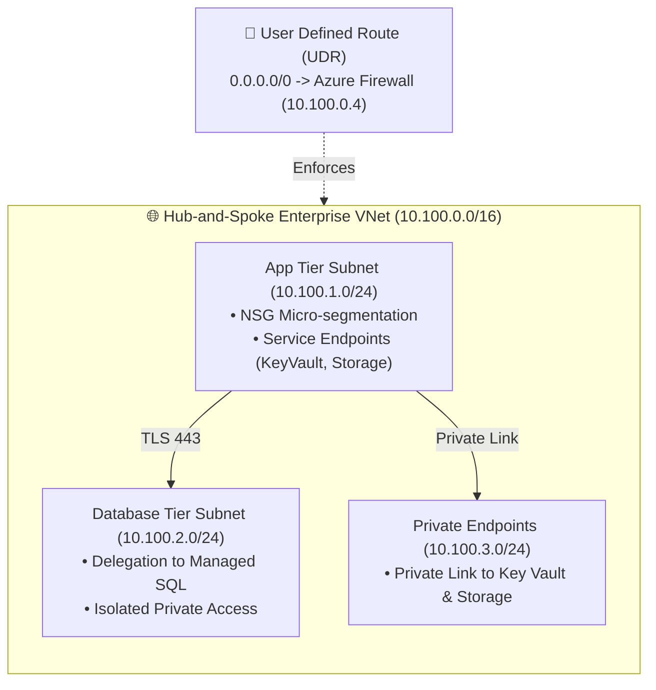

# 🏢 Azure Enterprise Landing Zone (Terraform Modules)

<div align="center">

[](https://www.terraform.io/)
[](https://azure.microsoft.com/)
[](https://www.checkov.io/)
[](LICENSE)

**Production-tested, modular Terraform architecture implementing Microsoft Cloud Adoption Framework (CAF), Hub-and-Spoke topology, Zero Trust perimeter, and advanced HCL constructs.**

[Threat Model](docs/threat-model.md) · [Operations Runbook](docs/operations-runbook.md) · [Security Policy](SECURITY.md) · [CI Pipeline](.github/workflows/terraform-ci.yml)

</div>

---

## 🧭 Architectural Topology

This landing zone deploys a resilient enterprise network isolating workloads into segmented subnets (`app-tier`, `db-tier`, and `private-endpoints`), forced through inspection via Azure Firewall with user-defined routes (`0.0.0.0/0`).



---

## ⚡ Advanced Terraform / HCL Engineering Highlights

This repository demonstrates senior-level Terraform patterns eliminating code duplication through data-driven dynamic configuration:

1. **`for_each` Subnet Generation with Nested `dynamic "delegation"` Blocks:**
   Subnets are modeled as complex `map(object({...}))` allowing individual subnets to dynamically declare delegations and service endpoints without hardcoded resources.
2. **`dynamic "security_rule"` NSG Generation:**
   Network security rules accept flexible single-value or multi-value port and CIDR arrays, dynamically unrolling into strict security policies.
3. **`dynamic "network_acls"` & `dynamic "access_policy"` in Key Vault:**
   Zero-Trust perimeter enforced directly at Key Vault deployment, binding allowed office IPs, App Tier subnets, and Managed Identities with least-privilege roles.
4. **`dynamic "data_disk"` & `dynamic "extension"` in VM Scale Sets:**
   Compute instances across availability zones (`zones = ["1","2","3"]`) receive standardized LUN attachments and monitoring extensions dynamically.

---

## 📂 Repository Structure

```
├── modules/
│   ├── networking/          # VNet, dynamic Subnet delegations, NSG dynamic rules, Route Tables
│   ├── key_vault/           # Zero-Trust Key Vault, dynamic access policies & network ACLs
│   ├── compute_scale_set/   # Linux VMSS across multi-zones, dynamic data disks & extensions
│   └── policy_governance/   # Azure Policy assignments with dynamic non-compliance messages
├── environments/
│   └── prod/                # Production composition, backend locking & terraform.tfvars
├── docs/
│   ├── threat-model.md      # STRIDE threat analysis matrix
│   └── operations-runbook.md# Drift remediation & emergency rollback playbooks
├── SECURITY.md              # Security & vulnerability reporting policy
└── .github/workflows/       # Automated CI/CD pipeline (fmt, tflint, Checkov, Infracost)
```

---

## 🚀 Quickstart & Validation

### Prerequisites
* Terraform `>= 1.6.0`
* Azure CLI `az login`
* `tflint` and `checkov` installed locally

### Step-by-Step Execution
```bash
# 1. Clone repository
git clone https://github.com/rushi-bonde/azure-enterprise-landingzone-tf.git
cd azure-enterprise-landingzone-tf/environments/prod

# 2. Initialize with remote state backend
terraform init

# 3. Code formatting & linting
terraform fmt -check -recursive ../../
tflint

# 4. Security inspection
checkov -d ../../modules

# 5. Plan deployment
terraform plan -var-file="terraform.tfvars"
```

---

## 🤝 Contributing & License
Maintained by **Rushikesh Bonde** · Licensed under the MIT License.